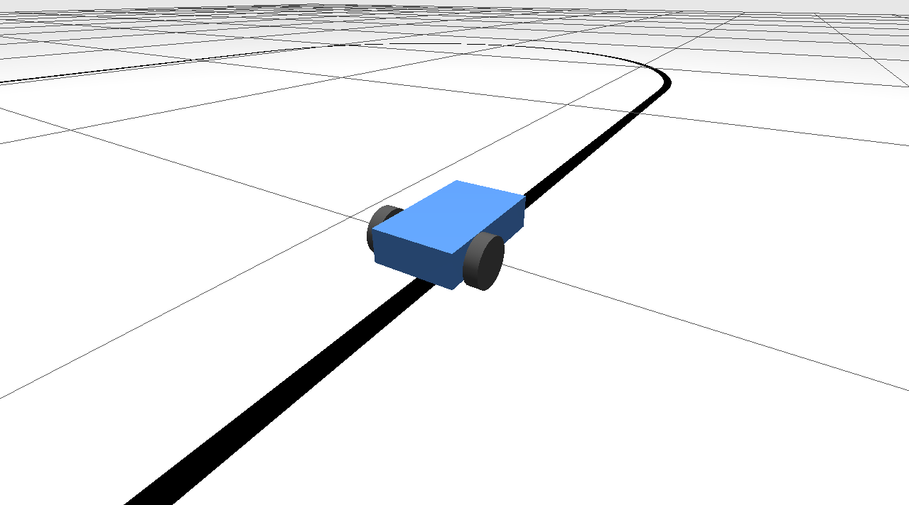

# Final Project — ROS Line Follower Robot

Final Group Project: design, simulate and document a line follower robot with infrared (IR / photodiode) style
line sensing in ROS and Gazebo.

> **[TO BE FILLED IN]** Group name · Members · Course · Lecturer

This repository contains two parts:

| Folder | What it is | ROS / simulator |
|---|---|---|
| [`line_follower_report_package/`](line_follower_report_package/) | Main project: robot with a 5-sensor virtual IR array, PID controller, 5 experiments, full report, figures and simulation video | ROS 2 Humble + Gazebo Fortress |
| [`ROS_Line_Follower_Noetic/`](ROS_Line_Follower_Noetic/) | Separate line follower variant (camera line-centroid controller that stops when the line ends), with ROS 1 Noetic and ROS 2 Humble launchers for WSL | ROS 1 Noetic + Gazebo Classic 11, and ROS 2 Humble + Gazebo Fortress |

## Main project at a glance

- **Report:** [`report.pdf`](line_follower_report_package/report.pdf) ·
  [`report.docx`](line_follower_report_package/report.docx) ·
  [`report.md`](line_follower_report_package/report.md)
- **Guide to the package:** [`00_READ_ME_FIRST.md`](line_follower_report_package/00_READ_ME_FIRST.md)
- **Video:** [`simulasi_line_follower.mp4`](line_follower_report_package/video/simulasi_line_follower.mp4)
  (one lap at 0.45 m/s)
- **Source code:** [`code/line_follower/`](line_follower_report_package/code/line_follower/) (ROS 2 `ament_python` package)
- **Data:** [`data/results.csv`](line_follower_report_package/data/results.csv) — source of every number in the report



Result summary (from `data/results.csv`, simulation time): all 5 runs finished a full lap without losing the line;
best configuration base_speed 0.45 m/s, kp = 3, kd = 0 with a lap time of 32.47 s.

## Running the main project

Ubuntu 22.04 with ROS 2 Humble and Gazebo Fortress (`ros-humble-ros-gz`):

```bash
mkdir -p ~/line_follower_ws/src
cp -r line_follower_report_package/code/line_follower ~/line_follower_ws/src/
cd ~/line_follower_ws
colcon build --symlink-install
source install/setup.bash
ros2 launch line_follower sim.launch.py follow:=true
```

In a virtual machine the launch file renders on the CPU by default (`software_gl:=true`); on a PC with a real GPU
add `software_gl:=false`. See the package [README](line_follower_report_package/code/line_follower/README.md) for
details.

## Running the Noetic variant

See [`ROS_Line_Follower_Noetic/README.md`](ROS_Line_Follower_Noetic/README.md).
