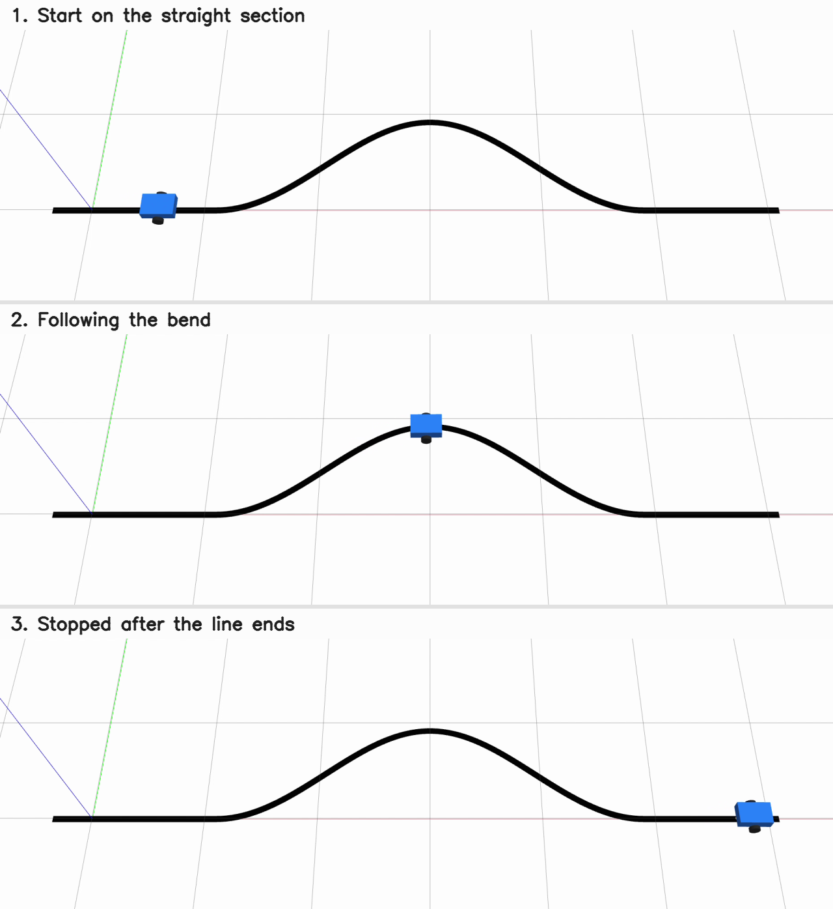
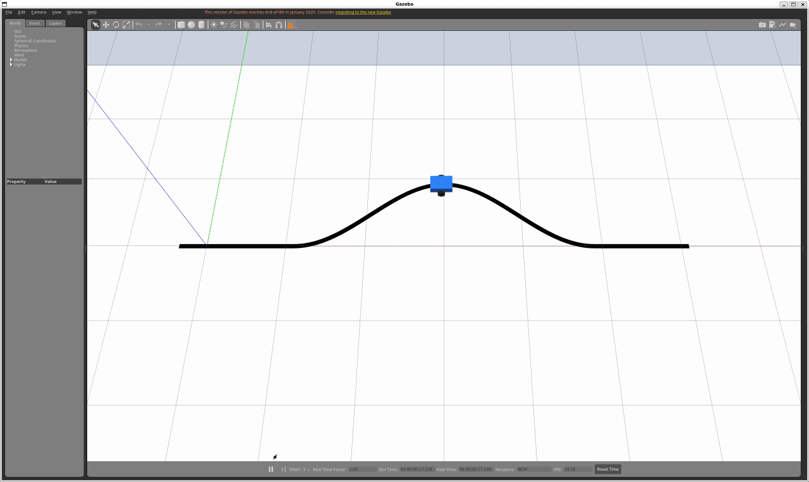

# Final Project — ROS Line Follower Robot

Final Group Project: design, simulate and document a line follower robot with infrared (IR / photodiode) style
line sensing in ROS and Gazebo.

## Group members

| Name | Student ID |
|---|---|
| Fariz Marsal Musyaffa | 25/555145/PA/23267 |
| Alfatih Zaidan Rafif | 25/569893/PA/24020 |
| Rofi Kasyidi Darmanto | 25/558667/PA/23476 |

**Course:** Robotics
**Lecturer:** Dr. Bakhtiar Alldino Ardi Sumbodo, S.Si., M.Cs.

## Contents

| Path | What it is | ROS / simulator |
|---|---|---|
| [`line_follower_report_package/`](line_follower_report_package/) | Main project: robot with a 5-sensor virtual IR array, PID controller, 5 experiments, full report, figures and simulation video | ROS 2 Humble + Gazebo Fortress |
| [`ROS_Line_Follower_Noetic/`](ROS_Line_Follower_Noetic/) | Line follower variant (camera line-centroid controller that stops when the line ends), with ROS 1 Noetic and ROS 2 Humble launchers for WSL, plus two ROS 1 demo videos | ROS 1 Noetic + Gazebo Classic 11, and ROS 2 Humble + Gazebo Fortress |
| [`ROS_Line_Follower_Comparison_Report.docx`](ROS_Line_Follower_Comparison_Report.docx) | Comparison report of the variant above: ROS 1 Noetic vs ROS 2 Humble on the same track, robot and controller | — |

## ROS 1 vs ROS 2 comparison

[`ROS_Line_Follower_Comparison_Report.docx`](ROS_Line_Follower_Comparison_Report.docx) compares the same line
follower (same line geometry, differential-drive robot, camera-based proportional controller and verification
criteria) running on **ROS 1 Noetic** (Ubuntu 20.04, Gazebo Classic 11) and **ROS 2 Humble** (Ubuntu 22.04, Gazebo
Fortress). Both configurations passed straight tracking, turning and the line-loss stop. Straight-line RMS error was
about 3 mm in both runs; through the turns, Noetic recorded 37.23 mm RMS error versus 77.73 mm for Humble.

Demo videos of the ROS 1 run: [`ros 1 part 1.mp4`](ROS_Line_Follower_Noetic/ros%201%20part%201.mp4) ·
[`ros 1 part 2.mp4`](ROS_Line_Follower_Noetic/ros%201%20part%202.mp4)

## Main project at a glance

The project has a ROS 2 part and a ROS 1 part.

### ROS 2 Humble — IR line follower (Gazebo Fortress)

- **Report:** [`report.pdf`](line_follower_report_package/report.pdf) ·
  [`report.docx`](line_follower_report_package/report.docx) ·
  [`report.md`](line_follower_report_package/report.md)
- **Guide to the package:** [`00_READ_ME_FIRST.md`](line_follower_report_package/00_READ_ME_FIRST.md)
- **Video:** [`simulasi_line_follower.mp4`](line_follower_report_package/video/simulasi_line_follower.mp4)
  (one lap at 0.45 m/s)
- **Source code:** [`code/line_follower/`](line_follower_report_package/code/line_follower/) (ROS 2 `ament_python` package)
- **Data:** [`data/results.csv`](line_follower_report_package/data/results.csv) — source of every number in the report


Result summary (from `data/results.csv`, simulation time): all 5 runs finished a full lap without losing the line;
best configuration base_speed 0.45 m/s, kp = 3, kd = 0 with a lap time of 32.47 s.

### ROS 1 Noetic — camera line follower (Gazebo Classic 11)

- **Description and instructions:** [`ROS_Line_Follower_Noetic/README.md`](ROS_Line_Follower_Noetic/README.md)
- **Source code:** [`noetic/`](ROS_Line_Follower_Noetic/noetic/) — ROS 1 package `line_follower_noetic`:
  controller node ([`node.py`](ROS_Line_Follower_Noetic/noetic/node.py)), world generator
  ([`make_world.py`](ROS_Line_Follower_Noetic/noetic/make_world.py)), launch file
  ([`simulation.launch`](ROS_Line_Follower_Noetic/noetic/simulation.launch)), setup and run scripts
- **Videos:** [`ros 1 part 1.mp4`](ROS_Line_Follower_Noetic/ros%201%20part%201.mp4) ·
  [`ros 1 part 2.mp4`](ROS_Line_Follower_Noetic/ros%201%20part%202.mp4)
- **Results and comparison with ROS 2:** [`ROS_Line_Follower_Comparison_Report.docx`](ROS_Line_Follower_Comparison_Report.docx)
- **Screenshots:** [`screenshots/`](ROS_Line_Follower_Noetic/screenshots/) (frames taken from `ros 1 part 1.mp4`)





The robot follows a straight section and bends with a downward camera and a proportional controller, and stops
when the line ends. Gazebo ROS plugins publish `/camera/image` and `/odom` and receive `/cmd_vel`.

Result summary (from the comparison report): the ROS 1 Noetic run passed all three checks (straight tracking,
turning and line-loss stop). Straight RMS error 2.98 mm, turns RMS error 37.23 mm (peak 63.15 mm), final forward
position 5.764 m, qualifying stop 1.02 s.

## Running the project

### ROS 2 Humble part

Ubuntu 22.04 with ROS 2 Humble and Gazebo Fortress (`ros-humble-ros-gz`):

```bash
mkdir -p ~/line_follower_ws/src
cp -r line_follower_report_package/code/line_follower ~/line_follower_ws/src/
cd ~/line_follower_ws
colcon build --symlink-install
source install/setup.bash
ros2 launch line_follower sim.launch.py follow:=true
```

In a virtual machine the launch file renders on the CPU by default (`software_gl:=true`); on a PC with a real GPU
add `software_gl:=false`. See the package [README](line_follower_report_package/code/line_follower/README.md) for
details.

### ROS 1 Noetic part

Ubuntu 20.04 (e.g. WSL `Ubuntu-20.04`) with ROS 1 Noetic and Gazebo Classic 11, from the
`ROS_Line_Follower_Noetic` folder:

```bash
cd ROS_Line_Follower_Noetic
bash noetic/setup.sh                 # installs ROS Noetic + Gazebo 11 (once)
bash noetic/run.sh verify auto       # sets up the package and world, runs, and checks straight
                                     # tracking, turns and the line-loss stop
bash noetic/run.sh demo gui          # keep the Gazebo window open after the robot stops
```

The launcher uses software rendering by default. See
[`ROS_Line_Follower_Noetic/README.md`](ROS_Line_Follower_Noetic/README.md) for details, including the ROS 2 Humble
launcher of this variant for Windows/WSL.
