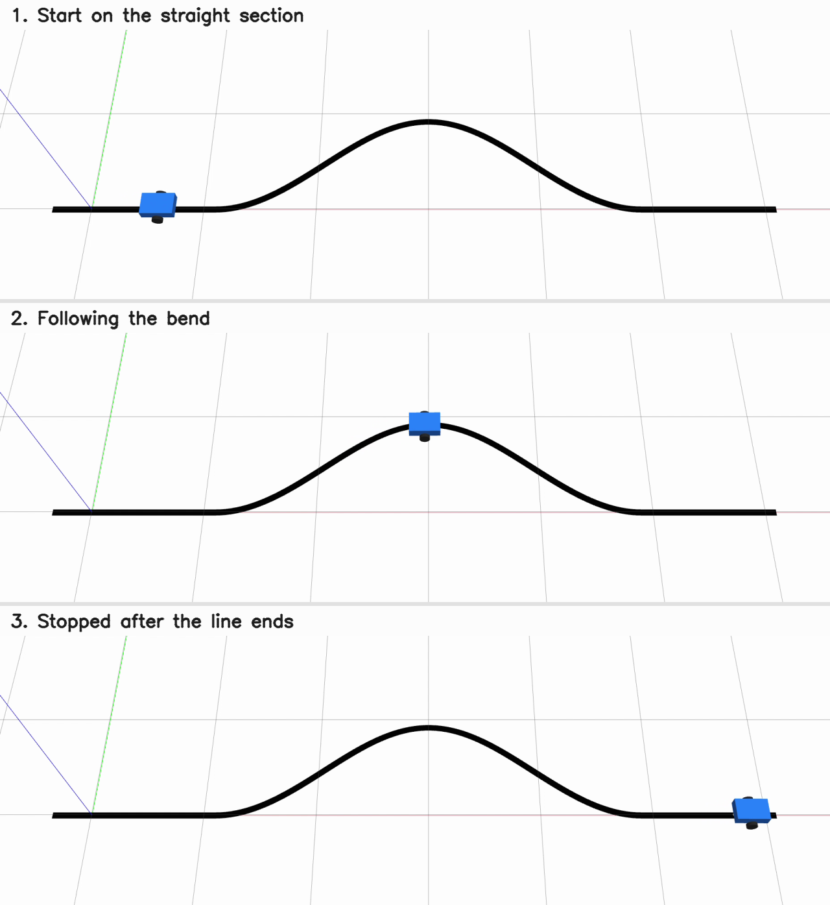
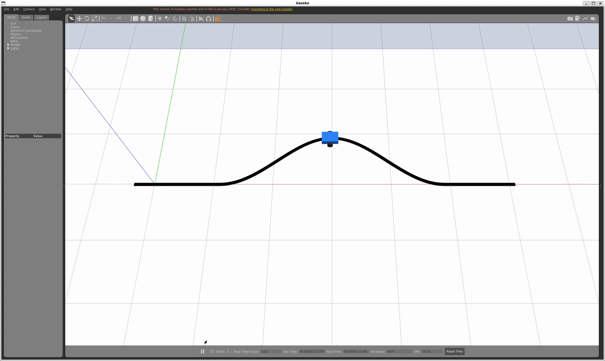

# ROS Line Follower

This project uses a differential-drive robot, a downward-facing camera, and a proportional controller to follow a black line through a straight section and bends. The robot stops when the camera can no longer see the line. The class notice describes the TurtleBot3 Navigation exercise separately. Ubuntu 22.04, ROS 2 Humble, Gazebo Fortress, and the verification thresholds here are baseline choices pending the detailed line-follower brief.

## Run with ROS 1 Noetic

Noetic uses Ubuntu 20.04 and Gazebo Classic 11. Install Ubuntu 20.04 alongside Ubuntu 22.04 from Windows PowerShell with `wsl.exe --install --web-download -d Ubuntu-20.04` if needed. Complete its first-launch user setup and enter the project directory in the Ubuntu 20.04 terminal.

```bash
bash noetic/setup.sh && bash noetic/run.sh verify auto
```

Use `bash noetic/run.sh demo gui` to keep the Gazebo window open after the robot stops, or `bash noetic/run.sh verify headless` for verification in a virtual display. The launcher uses software rendering by default. The ROS 1 Gazebo plugins publish `/camera/image` and `/odom` and receive `/cmd_vel`. The Noetic and Humble versions share the track, controller math, and verification criteria.

Noetic writes results to `evidence/noetic-verify-*/`. A Noetic run on Ubuntu 20.04.6 with Gazebo Classic 11.15.1 passed all three checks (straight tracking, turns and line-loss stop); see the results and the comparison with ROS 2 Humble in [ROS_Line_Follower_Comparison_Report.docx](../ROS_Line_Follower_Comparison_Report.docx), and the demo videos [ros 1 part 1.mp4](ros%201%20part%201.mp4) and [ros 1 part 2.mp4](ros%201%20part%202.mp4). Noetic and Gazebo Classic are end of life and are used here for the requested ROS 1 run.

### Screenshots (ROS 1 Noetic, Gazebo Classic 11)

Frames taken from [ros 1 part 1.mp4](ros%201%20part%201.mp4): the robot starts on the straight section, follows the
bend, and stops after the line ends.





## First run with ROS 2 Humble on Windows

Open regular Windows PowerShell in this project folder. If using the ZIP, extract it first and open PowerShell in the extracted folder containing `setup.sh`.

```powershell
wsl.exe --list --verbose
# If Ubuntu-22.04 is missing, run the next command in Administrator PowerShell.
# wsl.exe --install -d Ubuntu-22.04
# Complete Ubuntu's first-launch user setup, then return to this folder.
wsl.exe -d Ubuntu-22.04 --cd $PWD.Path --exec bash -c 'bash ./setup.sh && LIBGL_ALWAYS_SOFTWARE=1 bash ./run.sh verify auto'
```

If an existing WSL 2 Ubuntu 22.04 instance has a different registered name, use that name after `-d`. If Windows prompts for a reboot during installation, reboot and rerun from this folder. Setup installs the ROS and Gazebo packages in Ubuntu, builds the project, and writes the package versions to `evidence/setup-*.log`. It reuses installed dependencies on later runs.

If WSL reports `Wsl/E_ACCESSDENIED`, run the setup from the Ubuntu terminal in the project folder with `bash ./setup.sh`. The verification run used software rendering to avoid the OGRE2 `GL3PlusTextureGpu::copyTo` crash observed on this computer.

## Run again

Run the simulator interactively from Windows PowerShell in this folder. Gazebo opens through WSLg when a graphical display is available. Use Ctrl+C to stop.

```powershell
wsl.exe -d Ubuntu-22.04 --cd $PWD.Path --exec env LIBGL_ALWAYS_SOFTWARE=1 bash ./run.sh demo auto
```

From Ubuntu in this folder, run `LIBGL_ALWAYS_SOFTWARE=1 bash ./run.sh verify auto` to repeat the checks. Choose `gui` to require a visible display or `headless` to run the Gazebo server with EGL rendering. The verifier exits automatically after it measures the finish-zone stop or reaches a timeout.

## Live checks and evidence

The launch starts the Gazebo world, ROS–Gazebo bridge, and controller. The camera publishes `/camera/image` as `sensor_msgs/msg/Image`. The controller publishes `/cmd_vel` as `geometry_msgs/msg/Twist`. DiffDrive supplies `/odom` as `nav_msgs/msg/Odometry`.

The controller tracks the line centroid from two image bands and reduces forward speed during turns. It sends zero linear and angular commands when the line disappears or the camera stream goes stale for 0.45 seconds.

| Check | Baseline criterion |
| --- | --- |
| Straight and bends | Traverse each section with at most 0.12 m RMS deviation from the centerline, measured using wheel odometry |
| Line-loss stop | Beyond the bends, the camera detects no line and commands stay at zero, with odometry speed within 0.015 m/s and yaw rate within 0.08 rad/s for at least one second |

Each verification run writes `launch.log`, `track.sdf`, `tracking.csv` and `result.json` to a new `evidence/verify-*/` directory. If launch fails before the verifier receives data, see `launch.log`. Re-run the same case after changing the parameters in `controller.py` and rebuilding with `bash setup.sh`.

## Verified run on 22 November 2026

The simulation ran in Ubuntu 22.04.5 on WSL 2.7.3 with ROS 2 Humble and Gazebo Fortress 6.18.0. The verifier used wheel odometry to measure deviation from the configured track centerline.

| Check | Result | RMS error | Peak error | Samples used |
| --- | --- | ---: | ---: | ---: |
| Straight tracking | Passed | 3.08 mm | 10.19 mm | 24 |
| Turns | Passed | 77.73 mm | 149.30 mm | 220 |
| Line-loss stop | Passed | — | — | 12 stop samples |

The robot stopped at x = 5.951 m, inside the finish zone that started at x = 5.480 m. The qualifying stop lasted 1.10 s across the recorded samples. The final sample showed zero commanded and odometry-derived linear and angular velocities. The passing run contains 321 recorded samples. See [result.json](evidence/verify-20261122-140034-YBve/result.json), [tracking.csv](evidence/verify-20261122-140034-YBve/tracking.csv), and [launch.log](evidence/verify-20261122-140034-YBve/launch.log).

## References

- [Microsoft WSL installation](https://learn.microsoft.com/en-us/windows/wsl/install)
- [ROS 2 Humble packages for Ubuntu](https://docs.ros.org/en/humble/Installation/Ubuntu-Install-Debs.html)
- [Gazebo and ROS version compatibility](https://gazebosim.org/docs/latest/ros_installation/)
