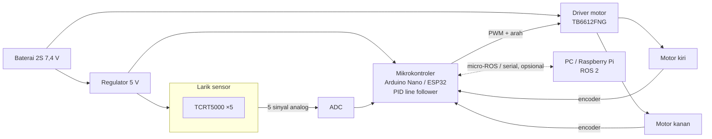
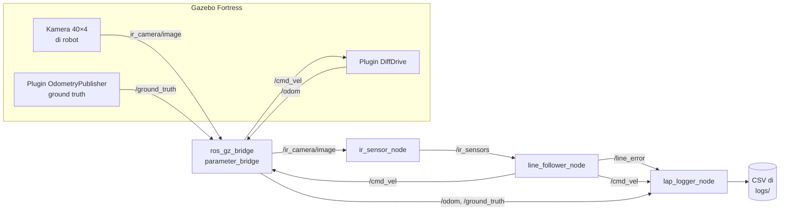

> **Arsip / archive:** draf laporan berbahasa Indonesia (versi sebelum video, close-up, dan diagram PNG). Laporan utama sekarang: [`report.md`](report.md) (English).

# Laporan Final Group Project: Robot Line Follower dengan Sensor IR

**Simulasi di ROS 2 Humble + Gazebo Fortress**

> **[PERLU DIISI KELOMPOK]** Nama kelompok · Anggota dan NIM · Mata kuliah · Dosen pengampu · Tanggal

---

## 1. Tujuan dan ruang lingkup

**Tujuan.** Merancang, mensimulasikan, dan mendokumentasikan robot *line follower* beroda diferensial yang
mendeteksi garis hitam di lantai putih memakai larik sensor inframerah (IR/fotodioda), lalu mengikuti
garis tersebut dengan kontroler PID.

**Ruang lingkup.**

| Termasuk | Tidak termasuk |
|---|---|
| Model robot 3D (SDF) dan jalur uji di Gazebo Fortress | Pembuatan robot fisik |
| Simulasi larik 5 sensor IR (dengan kamera kecil, lihat §2.3) | Derau sensor, variasi cahaya, lantai tidak rata |
| Node ROS 2: sensor, kontroler PID, logger | Persimpangan, garis putus-putus, rintangan |
| Eksperimen kecepatan dan tuning kp/kd, grafik | Validasi pada perangkat keras nyata |
| Usulan padanan perangkat keras nyata (§3) | |

---

## 2. Desain robot

### 2.1 Dimensi

Semua nilai berasal dari `models/line_robot/model.sdf`.

| Bagian | Nilai |
|---|---|
| Chassis | kotak 20 × 12 × 5 cm, massa 0,8 kg, dasar 1,5 cm di atas lantai |
| Roda penggerak | 2 buah, jari-jari 3,5 cm, lebar 2 cm, massa 0,05 kg, di x = −5 cm |
| Jarak antar roda (*wheel separation*) | 15 cm |
| Caster | bola jari-jari 1,5 cm di x = +7 cm, gesekan 0 (hanya meluncur) |
| Penggerak | plugin `DiffDrive`: input `/cmd_vel`, output `/odom`, akselerasi maks 1,0 m/s² dan 4,0 rad/s² |
| Larik sensor IR | kamera 40 × 4 piksel, 4 cm di atas lantai, di x = +11 cm, menghadap ke bawah, 30 Hz |

Sumbu: x = depan, y = kiri, z = atas, dengan titik asal di lantai tepat di bawah pusat chassis.


> **[OPSIONAL]** Screenshot di atas diambil otomatis dari GUI Gazebo. Ganti dengan screenshot close-up
> robot buatan kelompok jika ingin tampilan yang lebih jelas.

### 2.2 Posisi sensor

- Sensor berada **16 cm di depan poros roda** (x = +11 cm, poros di x = −5 cm). Dengan begitu robot
  "melihat" tikungan sebelum rodanya sampai di sana.
- Kamera berada 4 cm di atas lantai dengan sudut pandang horizontal 90°, sehingga melihat potongan
  lantai selebar 2 · 0,04 · tan(45°) = **8 cm** (2 mm per piksel).
- Lima sensor virtual berjarak **1,5 cm**, total bentang 6 cm, jatuh di kolom piksel
  `[5, 12, 20, 27, 34]` dari 40 (dicetak `ir_sensor_node` saat start).
- Garis hitam lebar **3 cm**: saat robot tepat di tengah garis, sensor tengah gelap penuh (0,0) dan
  dua tetangganya separuh gelap (0,33). Ini memberi informasi posisi yang lebih halus daripada 0/1 saja.

### 2.3 Alasan memakai kamera sebagai sensor IR

Gazebo tidak menyediakan sensor reflektansi inframerah, sehingga larik sensor IR disimulasikan dengan
kamera beresolusi sangat rendah yang menghadap lantai, dan setiap sensor virtual adalah rata-rata
kecerahan beberapa piksel, sama seperti fotodioda yang mengukur intensitas pantulan cahaya pada satu
titik. Pendekatan ini membuat jumlah dan jarak antar sensor dapat diubah lewat parameter tanpa mengubah
model robot, serta tetap ringan karena gambar yang dirender hanya 40×4 piksel.

---

## 3. Padanan perangkat keras nyata

Bagian ini adalah **usulan** komponen jika robot dibuat secara fisik. Komponen ini belum diuji.

| Fungsi | Di simulasi | Padanan nyata (usulan) |
|---|---|---|
| Sensor garis | 5 titik dari kamera 40×4 px | 5 × **TCRT5000** (LED IR 950 nm + fototransistor), jarak antar sensor ±1,5 cm |
| Pembacaan sensor | nilai 0,0–1,0 | **ADC** mikrokontroler (analog, cocok untuk rata-rata berbobot); alternatif **komparator LM393** (digital 0/1, lebih sederhana tapi error jadi kasar) |
| Pengendali | `line_follower_node` (Python, ROS 2) | Mikrokontroler, misalnya **Arduino Nano** (8 input ADC 10-bit) atau **ESP32** (bisa menjalankan micro-ROS untuk terhubung ke ROS 2) |
| Driver motor | plugin `DiffDrive` | **TB6612FNG** (dual H-bridge, efisien) atau L298N |
| Motor | sendi roda di SDF | 2 × motor DC gearbox (misalnya N20) dengan **encoder** untuk odometri |
| Caster | bola tanpa gesekan | ball caster logam |
| Catu daya | — | baterai 2S Li-ion 7,4 V + regulator 5 V |

Diagram blok perangkat keras:



Catatan penting untuk versi fisik: TCRT5000 bekerja optimal pada jarak sangat dekat dengan lantai
(beberapa milimeter). Jadi sensor nyata harus dipasang jauh lebih rendah daripada kamera simulasi
(4 cm). Ambang `line_threshold` dan skala nilai juga harus dikalibrasi ulang di lantai sebenarnya.

---

## 4. Arsitektur perangkat lunak

Semua kode ada di package ROS 2 `line_follower` (tipe `ament_python`).



| Node | Subscribe | Publish | Tugas |
|---|---|---|---|
| `ir_sensor_node` | `/ir_camera/image` | `/ir_sensors` | Mengambil N titik dari gambar → nilai 0 (hitam) … 1 (putih), urutan kiri → kanan |
| `line_follower_node` | `/ir_sensors` | `/cmd_vel`, `/line_error` | Kontroler PID + pencarian garis saat garis hilang |
| `lap_logger_node` | `/odom`, `/ground_truth`, `/cmd_vel`, `/line_error` | — (file CSV) | Log 10 baris/detik + deteksi waktu satu putaran |
| `parameter_bridge` | — | — | Menerjemahkan pesan Gazebo ↔ ROS 2 |
| `create` (ros_gz_sim) | — | — | Memunculkan robot di x = 0, y = −1,2, menghadap +x |

| Topic | Tipe pesan | Arah |
|---|---|---|
| `/cmd_vel` | `geometry_msgs/Twist` | ROS → Gazebo |
| `/odom` | `nav_msgs/Odometry` | Gazebo → ROS (odometri roda, bisa melenceng saat roda selip) |
| `/ground_truth` | `nav_msgs/Odometry` | Gazebo → ROS (posisi sebenarnya, **hanya untuk evaluasi**) |
| `/ir_camera/image` | `sensor_msgs/Image` | Gazebo → ROS |
| `/ir_sensors` | `std_msgs/Float32MultiArray` | dari `ir_sensor_node` |
| `/line_error` | `std_msgs/Float32` | dari `line_follower_node` |
| `/clock` | `rosgraph_msgs/Clock` | Gazebo → ROS (waktu simulasi) |

Kontroler **tidak** memakai `/odom` maupun `/ground_truth`. Robot hanya mengandalkan sensor IR,
sama seperti robot line follower sungguhan.

Semua parameter ada di `config/follower.yaml` dan dibaca saat launch, jadi bisa diubah tanpa build ulang.

---

## 5. Algoritma kontrol

Setiap kali data `/ir_sensors` datang (±30 kali per detik):

1. **Kegelapan** tiap sensor: dᵢ = 1 − nilaiᵢ.
2. **Bobot simetris**, kiri positif: w = [+2, +1, 0, −1, −2] untuk 5 sensor.
3. **Error** = posisi garis relatif terhadap tengah, diskalakan ke −1…+1:

   error = (Σ dᵢ·wᵢ / Σ dᵢ) / 2

   Nilai +1 berarti garis di sensor paling kiri, −1 di sensor paling kanan.
4. **PID** menghasilkan kecepatan belok (positif = belok kiri), dibatasi `max_angular`:

   ω = kp·error + ki·∫error dt + kd·d(error)/dt

5. **Kecepatan maju** turun saat error besar:

   v = max(min_speed, base_speed · (1 − |error|))

6. **Garis hilang**: jika tidak ada sensor dengan kegelapan > `line_threshold` (0,4), robot berhenti maju
   dan **berputar di tempat** dengan `search_speed` ke arah sisi terakhir garis terlihat. Begitu ada sensor
   yang melihat garis lagi, kontrol PID dilanjutkan (integral di-reset).
7. **Watchdog**: jika data sensor tidak datang selama 0,5 s, robot dihentikan.

### 5.1 Analisis error di tikungan (kontroler P)

Di tikungan berjari-jari R, robot harus berbelok dengan ω = v / R. Dengan kontroler P murni, ω = kp·e,
sehingga perlu error tetap e = v / (R·kp). Karena v sendiri turun menjadi base_speed·(1 − e), maka:

e = a / (1 + a),  dengan a = base_speed / (R·kp)

Jadi **error di tikungan naik seiring kecepatan dan turun jika kp dinaikkan**. Ini terlihat di hasil
eksperimen (§7).

Perbandingan teori dengan pengukuran (kolom `mean_error_in_curves` di `docs/results.csv`, yaitu rata-rata
error selama pusat robot berada di busur tikungan):

| Run | a = base_speed / (R·kp) | Teori e = a / (1 + a) | Terukur |
|---|---|---|---|
| 0,15 m/s, kp = 1 | 0,125 | 0,111 | 0,1112 |
| 0,25 m/s, kp = 1 | 0,208 | 0,172 | 0,1722 |
| 0,35 m/s, kp = 1 | 0,292 | 0,226 | 0,2253 |
| 0,45 m/s, kp = 1 | 0,375 | 0,273 | 0,2722 |
| 0,45 m/s, kp = 3 | 0,125 | 0,111 | 0,1142 |

Model sederhana ini cocok dengan simulasi sampai selisih ≤ 0,004. Artinya robot benar-benar berperilaku
sebagai kontroler P, dan menaikkan kp dari 1 ke 3 memperkecil error di tikungan sekitar 2,4 kali.

---

## 6. Setup simulasi

| Item | Nilai |
|---|---|
| Perangkat lunak | Ubuntu 22.04 (arm64, VM), ROS 2 Humble, Gazebo Fortress (ign-gazebo 6), `ros_gz` |
| Jalur | oval (*stadium*): 2 garis lurus 3 m + 2 setengah lingkaran R = 1,2 m, lebar garis 3 cm, 270 segmen kotak hitam setebal 1 mm tanpa *collision* di lantai putih |
| Keliling jalur | 2·3 + 2π·1,2 = **13,54 m** |
| Posisi start | x = 0, y = −1,2 (tengah garis lurus bawah), menghadap +x, sehingga robot berputar berlawanan arah jarum jam |
| Fisika | langkah 1 ms, gesekan roda μ = 1,0, caster μ = 0 |
| Pencahayaan | 2 lampu directional tanpa bayangan, ambient 0,8 |
| Rendering | `ogre2` lewat CPU (`LIBGL_ALWAYS_SOFTWARE=1`), karena driver GPU VM membuat Gazebo crash |
| Waktu | semua durasi di laporan adalah **waktu simulasi** (`use_sim_time`), bukan waktu jam dinding |

**Prosedur eksperimen** (`scripts/run_experiments.py`). Untuk setiap kombinasi parameter:

1. Semua proses simulasi lama dimatikan.
2. Simulasi dijalankan *headless* (tanpa GUI) dengan `follow:=true`.
3. Run berhenti saat satu putaran selesai, atau saat batas waktu tercapai
   (1,8 × keliling / base_speed + 40 s).
4. Metrik dihitung dari CSV run tersebut.

**Definisi metrik** (kolom `docs/results.csv`):

| Kolom | Arti |
|---|---|
| `completed` | 1 jika robot kembali ke dalam radius 15 cm dari titik start setelah menempuh ≥ 5 m (diukur dengan ground truth) **dan** arahnya berlawanan jarum jam |
| `lap_time_s` | waktu simulasi satu putaran |
| `mean_abs_error`, `max_abs_error` | rata-rata dan maksimum \|error\| selama putaran (0 = garis di tengah, 1 = garis di sensor terluar) |
| `line_lost_count` | berapa kali garis hilang dan robot masuk mode pencarian |
| `max_deviation_m` | jarak terjauh pusat robot (ground truth) dari tengah garis |
| `lap_distance_m` | jarak tempuh selama satu putaran (ground truth) |

Posisi untuk evaluasi diambil dari **ground truth** Gazebo, bukan dari `/odom`. Pada percobaan awal yang
memakai `/odom`, deteksi putaran di kecepatan tinggi keliru: satu run tercatat menempuh 25,9 m untuk satu
"putaran" (`docs/results_odom_only.csv`, run `v2.50_kp3_ki0_kd0`), karena odometri roda melenceng saat
roda selip.

---

## 7. Hasil eksperimen

### 7.1 Daftar eksperimen

Jumlah eksperimen **dibatasi 5 run** agar waktu simulasi di VM tetap wajar. Run dipilih sebagai berikut:

| Peran | base_speed | kp | kd | Alasan |
|---|---|---|---|---|
| Baseline | 0,15 m/s | 1,0 | 0 | parameter awal kontroler |
| Kecepatan menengah 1 | 0,25 m/s | 1,0 | 0 | melihat tren |
| Kecepatan menengah 2 | 0,35 m/s | 1,0 | 0 | melihat tren |
| Kecepatan tertinggi (kp = 1) | 0,45 m/s | 1,0 | 0 | kecepatan tertinggi yang diuji dengan kp = 1 dan tetap menyelesaikan putaran |
| Kecepatan tertinggi, hasil tuning | 0,45 m/s | 3,0 | 0 | kp/kd terbaik dari tuning (lihat §7.4) |

Semua angka di bawah ini berasal dari `docs/results.csv`. Log per run ada di
`~/line_follower_ws/logs/experiments/<run>/`.

### 7.2 Ringkasan hasil

| Run | Selesai | Waktu putaran (s) | Rata-rata \|error\| | Maks \|error\| | Garis hilang | Kecepatan rata-rata (m/s) | Simpangan maks (cm) | Jarak tempuh (m) |
|---|---|---|---|---|---|---|---|---|
| 0,15 m/s, kp = 1 | ya | 95,30 | 0,0662 | 0,1296 | 0 | 0,1401 | 0,86 | 13,34 |
| 0,25 m/s, kp = 1 | ya | 59,87 | 0,1048 | 0,2200 | 0 | 0,2238 | 0,77 | 13,35 |
| 0,35 m/s, kp = 1 | ya | 44,71 | 0,1411 | 0,2500 | 0 | 0,3006 | 0,72 | 13,35 |
| 0,45 m/s, kp = 1 | ya | 36,31 | 0,1735 | 0,3333 | 0 | 0,3719 | 0,59 | 13,40 |
| **0,45 m/s, kp = 3** | **ya** | **32,47** | **0,0776** | **0,1923** | **0** | **0,4151** | **0,86** | **13,35** |

"Kecepatan rata-rata" adalah rata-rata perintah `linear.x`. "Simpangan maks" adalah jarak terjauh pusat
robot (ground truth) dari tengah garis.

**Pengamatan:**

1. **Kelima run menyelesaikan satu putaran penuh**, berlawanan arah jarum jam, dan garis tidak pernah
   hilang (`line_lost_count` = 0).
2. **Robot tetap sangat dekat dengan garis.** Simpangan pusat robot paling jauh 0,86 cm, jauh lebih kecil
   daripada setengah lebar garis (1,5 cm). Jarak tempuh 13,34–13,40 m mendekati keliling jalur 13,54 m.
   Jarak sedikit lebih pendek karena pusat robot berada sedikit di sisi dalam tikungan.
3. **Semakin cepat, semakin besar error** (kp = 1): rata-rata |error| naik dari 0,0662 (0,15 m/s) ke
   0,1735 (0,45 m/s). Penyebabnya dijelaskan oleh analisis §5.1: error di tikungan ≈ a / (1 + a).
4. **Kecepatan rata-rata lebih rendah dari base_speed** (misalnya 0,3719 m/s untuk base_speed 0,45),
   karena robot melambat di tikungan sesuai rumus v = base_speed·(1 − |error|).
5. **Tuning kp = 3 di 0,45 m/s** memangkas rata-rata |error| dari 0,1735 menjadi 0,0776 dan maks |error|
   dari 0,3333 menjadi 0,1923. Waktu putaran juga turun dari 36,31 s ke 32,47 s, karena error yang lebih
   kecil membuat robot tidak perlu melambat sebanyak sebelumnya di tikungan (kecepatan rata-rata naik
   dari 0,3719 ke 0,4151 m/s).
6. **Efek samping kp = 3:** perintah belok berganti arah 14 kali dalam satu putaran
   (`steering_sign_flips`), sedangkan dengan kp = 1 tidak pernah berganti arah. Di grafik error, ini
   terlihat sebagai osilasi kecil di sekitar t ≈ 13–18 s, saat robot keluar tikungan masuk ke garis lurus.
   Osilasinya kecil (simpangan tetap ≤ 0,86 cm), tapi ini tanda bahwa kp yang lebih tinggi lagi akan
   mulai membuat robot bergoyang.

### 7.3 Grafik

**Waktu satu putaran.** Semakin cepat semakin singkat. Tuning kp = 3 menghemat 3,84 s di 0,45 m/s.


**Error vs waktu.** Dua "dataran" di setiap panel adalah dua tikungan. Error positif berarti garis di
kiri robot, karena robot berputar ke kiri (berlawanan jarum jam). Tingginya dataran naik seiring
kecepatan dan turun saat kp = 3.


**Kecepatan maju vs waktu.** Robot melaju penuh di garis lurus dan melambat di tikungan.


**Lintasan.** Garis biru (posisi sebenarnya dari Gazebo) menempel di garis abu-abu (jalur) di semua run.


**Perbandingan gain di 0,45 m/s.**


### 7.4 Asal nilai kp = 3, kd = 0

Nilai ini dipilih dari percobaan tuning awal di 0,45 m/s, yang tersimpan di `docs/results_odom_only.csv`
(kp ∈ {1, 2, 3, 4}, kd ∈ {0; 0,05; 0,1}). Kolom error di file itu dihitung dari sensor, jadi tidak
terpengaruh masalah odometri (§7.5). Hasilnya:

- kp = 3, kd = 0 memberi rata-rata |error| terkecil (0,0744).
- Menambah kd justru **memperburuk**. Dengan kp = 3, maks |error| naik menjadi 0,7500 (kd = 0,05) dan
  0,9286 (kd = 0,1). Kombinasi kp = 4, kd = 0,1 bahkan **gagal**: garis hilang 2 kali dan putaran tidak
  selesai.

Penyebab yang paling mungkin: posisi garis dari sensor berubah dalam lompatan kecil (resolusi kamera
2 mm per piksel), dan suku D yang menurunkan sinyal berlompatan ini menghasilkan sentakan belok besar.
Suku D tanpa filter tidak cocok untuk sensor ini.

Run kp = 3 di §7.2 adalah run ulang dengan ground truth. Hasilnya (rata-rata |error| 0,0776) konsisten
dengan percobaan awal.

### 7.5 Catatan: odometri roda tidak bisa dipakai untuk evaluasi

Percobaan awal memakai `/odom` (odometri dari putaran roda) untuk mendeteksi putaran dan mengukur
simpangan. Ternyata **odometri melenceng, terutama saat roda selip di kecepatan tinggi**:

- Pada run eksplorasi base_speed 2,5 m/s (kp = 3), odometri mencatat jarak 25,90 m untuk satu
  "putaran", hampir dua kali keliling jalur (13,54 m)
  (`logs/experiments/v2.50_kp3_ki0_kd0/run_20261122_071523_laps.csv`).
- Bahkan di 0,15 m/s, simpangan maksimum menurut odometri 5,96 cm (`results_odom_only.csv`), sedangkan
  menurut ground truth hanya 0,86 cm (`results.csv`), dengan parameter yang sama.

Karena itu semua evaluasi posisi (deteksi putaran, simpangan, arah, jarak) memakai **`/ground_truth`**,
yaitu posisi sebenarnya dari Gazebo. Kontroler sendiri tetap tidak memakai posisi apa pun.

Percobaan eksplorasi di atas 0,45 m/s (0,6–3,0 m/s dengan kp = 3, di `results_odom_only.csv`) dinilai
memakai odometri, sehingga status "selesai"-nya tidak bisa dipercaya. Run-run itu **tidak** dipakai
untuk kesimpulan. Batas kecepatan maksimum robot ini belum ditentukan dengan ground truth (lihat §8).

---

## 8. Keterbatasan

1. **Sensor IR disimulasikan dengan kamera.** Kamera tidak meniru karakteristik TCRT5000 sungguhan:
   jarak kerja yang sangat dekat, sudut pancar LED, pengaruh cahaya matahari/lampu, dan perbedaan
   pantulan antar bahan lantai.
2. **Kondisi ideal.** Tidak ada derau sensor, cahaya selalu merata, lantai rata, dan garis bersih tanpa
   putus. Robot nyata akan menghadapi semua hal ini.
3. **Model motor sederhana.** Plugin `DiffDrive` langsung menghasilkan kecepatan roda yang diminta
   (hanya dibatasi akselerasi). Tidak ada model tegangan baterai, *deadband* motor, atau keterlambatan
   driver.
4. **Hanya 5 eksperimen di satu jalur oval.** Tidak diuji pada tikungan tajam, persimpangan, garis
   putus-putus, atau jalur berbentuk lain. Setiap konfigurasi hanya dijalankan sekali, sehingga variasi
   antar-run tidak diukur.
5. **Batas kecepatan maksimum belum diketahui.** Kecepatan tertinggi yang diuji dengan ground truth
   adalah 0,45 m/s, dan robot masih lolos dengan mudah. Percobaan di atas itu hanya dinilai dengan
   odometri yang tidak andal (§7.5).
6. **Suku D tidak berguna tanpa filter.** Dengan resolusi sensor saat ini, menambah kd memperburuk
   kontrol (§7.4). Perbaikan yang mungkin: filter *low-pass* pada turunan error, atau resolusi
   kamera/sensor yang lebih tinggi.
7. **Odometri roda tidak andal** saat roda selip. Pada robot nyata tanpa ground truth, evaluasi posisi
   perlu sensor tambahan (kamera dari atas, IMU, dan sebagainya).
8. **Rendering lewat CPU di VM.** Simulasi berjalan normal, tapi bisa lebih lambat dari waktu nyata.
   Karena itu semua durasi di laporan memakai waktu simulasi.

---

## 9. Cara menjalankan ulang

```bash
# 1. Build (sekali saja, atau setiap kali kode Python/model berubah)
cd ~/line_follower_ws
colcon build --symlink-install
source install/setup.bash

# 2. Simulasi dengan GUI, robot mengikuti garis (parameter dari config/follower.yaml)
ros2 launch line_follower sim.launch.py follow:=true
#    tanpa GUI:            tambahkan headless:=true
#    PC dengan GPU (bukan VM): tambahkan software_gl:=false

# 3. Pantau (di terminal lain, setelah source install/setup.bash)
ros2 topic echo /ir_sensors
ros2 topic echo /line_error

# 4. Ulangi 5 eksperimen laporan (±5 menit), lalu buat ulang grafik
python3 src/line_follower/scripts/run_experiments.py --speeds 0.15 0.25 0.35 0.45 --runs 0.45,3.0,0.0
python3 src/line_follower/scripts/make_figures.py
#    hitung ulang metrik dari log yang ada, tanpa simulasi:
python3 src/line_follower/scripts/run_experiments.py --reanalyse
```

Hasil per run ada di `~/line_follower_ws/logs/experiments/<nama_run>/`: CSV log, CSV putaran,
`params.yaml`, dan `launch.log`. Ringkasan ada di `docs/results.csv`.

Jika jendela Gazebo masih terbuka setelah Ctrl+C, jalankan `pkill -f "ign gazebo"` sebelum launch berikutnya.
Dua simulasi yang berjalan bersamaan akan saling mengganggu.

---

## 10. Bagian yang perlu dilengkapi kelompok

| Bagian | Yang perlu diisi |
|---|---|
| Halaman judul (atas) | nama kelompok, anggota dan NIM, mata kuliah, dosen, tanggal |
| §2.1 Screenshot | opsional: ganti `figures/gazebo_overview.png` dengan screenshot close-up robot |
| §3 Perangkat keras | jika dosen meminta: harga/ketersediaan komponen, atau skema rangkaian lengkap |
| Pembagian tugas | jika diminta: siapa mengerjakan apa |
| Kesimpulan / refleksi | jika format laporan kampus mewajibkan: pendapat kelompok sendiri |

---

## 11. Kesimpulan

- Robot line follower beroda diferensial dengan larik 5 sensor IR (disimulasikan dengan kamera
  40 × 4 piksel) berhasil dibuat dan disimulasikan di ROS 2 Humble + Gazebo Fortress.
- Dengan kontroler P, robot menyelesaikan satu putaran penuh di semua 5 eksperimen tanpa kehilangan
  garis. Simpangan pusat robot paling jauh 0,86 cm dari tengah garis.
- Error di tikungan naik seiring kecepatan dan cocok dengan model e = a / (1 + a), dengan
  a = base_speed / (R·kp).
- Konfigurasi terbaik dari eksperimen: **base_speed = 0,45 m/s, kp = 3, kd = 0**, dengan waktu putaran
  32,47 s dan rata-rata |error| 0,0776. Nilai ini menjadi default di `config/follower.yaml`.
- Evaluasi posisi harus memakai ground truth, karena odometri roda melenceng saat roda selip.
