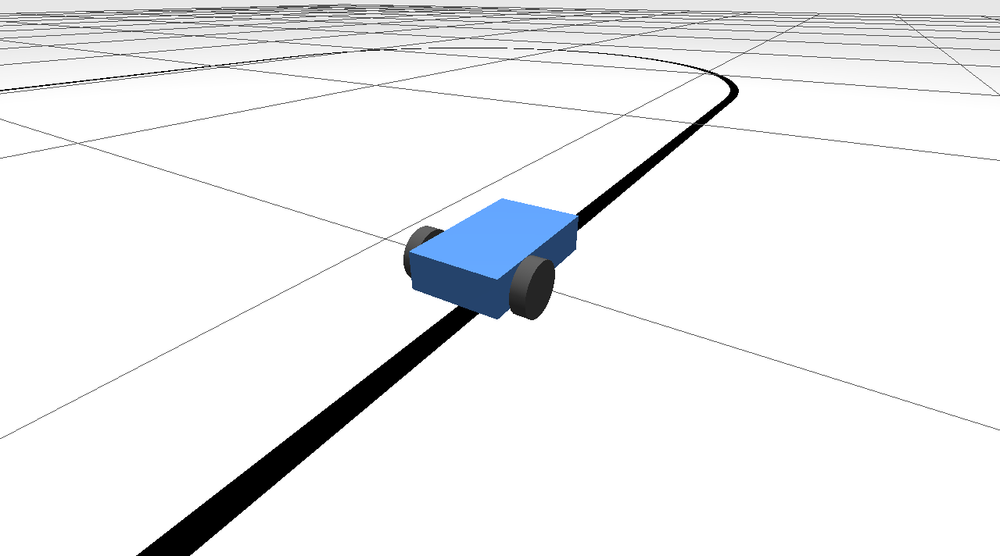
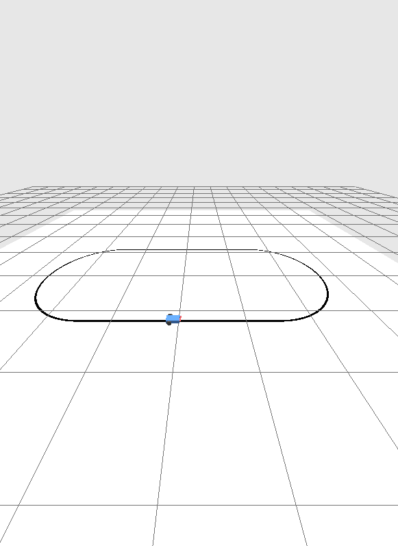
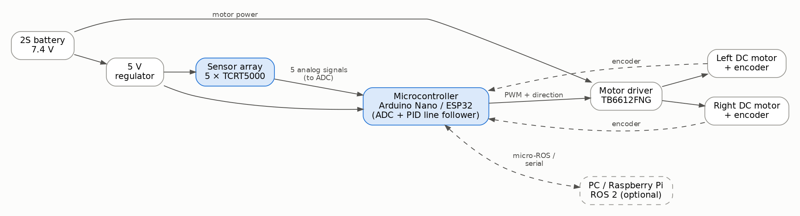
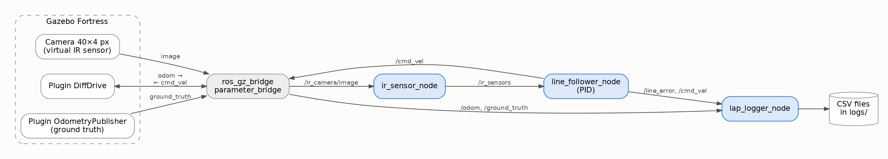
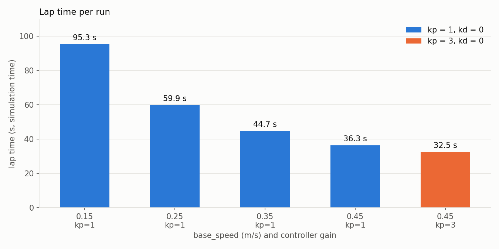
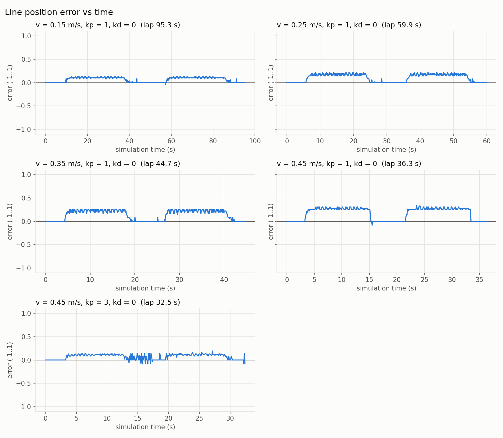
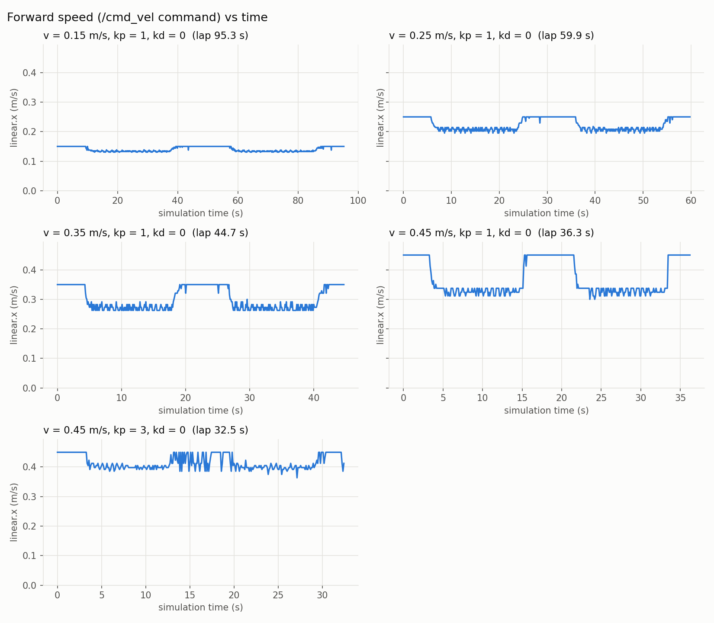
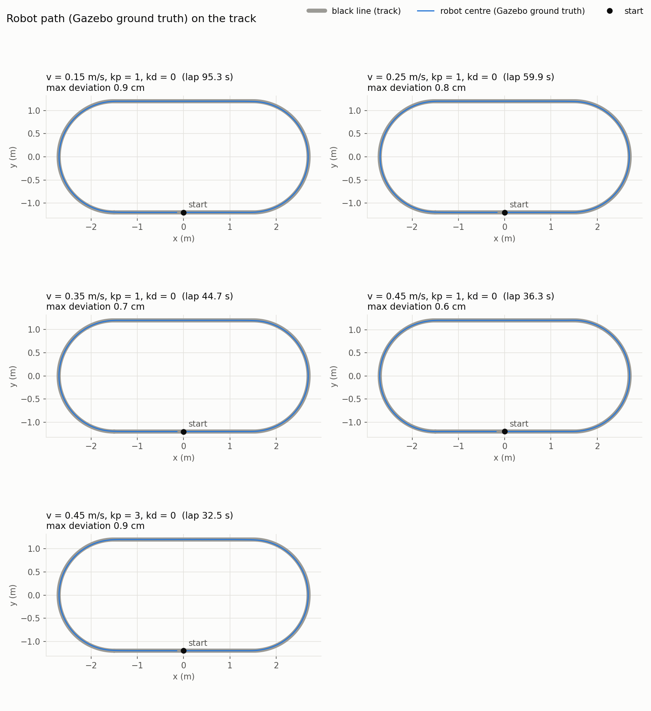
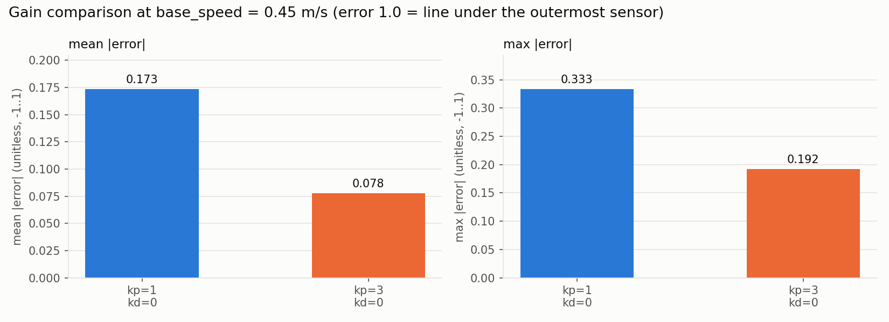

# Final Group Project Report: Line Follower Robot with IR Sensors

**Simulated in ROS 2 Humble + Gazebo Fortress**

**Course:** Robotics

**Lecturer:** Dr. Bakhtiar Alldino Ardi Sumbodo, S.Si., M.Cs.

| Group member | Student ID |
|---|---|
| Fariz Marsal Musyaffa | 25/555145/PA/23267 |
| Alfatih Zaidan Rafif | 25/569893/PA/24020 |
| Rofi Kasyidi Darmanto | 25/558667/PA/23476 |

---

## 1. Objective and scope

**Objective.** Design, simulate and document a differential-drive *line follower* robot that detects a black
line on a white floor with an array of infrared (IR / photodiode) sensors and follows it with a PID controller.

**Scope.**

| Included | Not included |
|---|---|
| 3D robot model (SDF) and test track in Gazebo Fortress | Building a physical robot |
| Simulated array of 5 IR sensors (using a small camera, see §2.3) | Sensor noise, changing light, uneven floor |
| ROS 2 nodes: sensor, PID controller, logger | Junctions, dashed lines, obstacles |
| Speed and gain experiments, figures, simulation video | Validation on real hardware |
| Proposed real-hardware equivalent (§3) | |

---

## 2. Robot design

### 2.1 Dimensions

All values come from `models/line_robot/model.sdf`.

| Part | Value |
|---|---|
| Chassis | box 20 × 12 × 5 cm, mass 0.8 kg, bottom 1.5 cm above the floor |
| Drive wheels | 2, radius 3.5 cm, width 2 cm, mass 0.05 kg, at x = −5 cm |
| Wheel separation | 15 cm |
| Caster | ball, radius 1.5 cm, at x = +7 cm, friction 0 (slides only) |
| Drive | `DiffDrive` plugin: input `/cmd_vel`, output `/odom`, max acceleration 1.0 m/s² and 4.0 rad/s² |
| IR sensor array | 40 × 4 pixel camera, 4 cm above the floor, at x = +11 cm, looking down, 30 Hz |

Axes: x = forward, y = left, z = up; the origin is on the floor directly below the chassis centre.





### 2.2 Sensor placement

- The sensors are **16 cm in front of the wheel axle** (x = +11 cm, axle at x = −5 cm), so the robot "sees"
  a curve before its wheels reach it.
- The camera is 4 cm above the floor with a 90° horizontal field of view, so it sees a strip of floor
  2 · 0.04 · tan(45°) = **8 cm** wide (2 mm per pixel).
- The five virtual sensors are **1.5 cm** apart (6 cm span) and fall on pixel columns
  `[5, 12, 20, 27, 34]` of 40 (printed by `ir_sensor_node` at start-up).
- The black line is **3 cm** wide: when the robot is centred, the middle sensor is fully dark (0.0) and its two
  neighbours are partly dark (0.33). This gives finer position information than plain 0/1 readings.

### 2.3 Why a camera is used as the IR sensor

Gazebo has no infrared reflectance sensor, so the IR sensor array is simulated with a very low-resolution
camera that looks at the floor, and each virtual sensor is the average brightness of a few pixels, just like a
photodiode that measures the intensity of reflected light at one spot. This makes the number of sensors and
their spacing configurable through parameters without changing the robot model, and keeps the simulation light
because only a 40×4 pixel image is rendered.

---

## 3. Real-hardware equivalent

This section is a **proposal** for building the robot physically; these parts have not been tested.

| Function | In simulation | Real equivalent (proposal) |
|---|---|---|
| Line sensor | 5 spots from a 40×4 px camera | 5 × **TCRT5000** (950 nm IR LED + phototransistor), about 1.5 cm apart |
| Sensor reading | values 0.0–1.0 | microcontroller **ADC** (analog, suits the weighted average); alternative: **LM393 comparator** (digital 0/1, simpler but a coarser error) |
| Controller | `line_follower_node` (Python, ROS 2) | microcontroller, e.g. **Arduino Nano** (8 × 10-bit ADC inputs) or **ESP32** (can run micro-ROS to talk to ROS 2) |
| Motor driver | `DiffDrive` plugin | **TB6612FNG** (dual H-bridge, efficient) or L298N |
| Motors | wheel joints in the SDF | 2 × geared DC motors (e.g. N20) with **encoders** for odometry |
| Caster | frictionless ball | metal ball caster |
| Power | — | 2S Li-ion battery 7.4 V + 5 V regulator |

Hardware block diagram (source: `docs/diagrams/hardware.dot`):



Important for a physical build: the TCRT5000 works best very close to the floor (a few millimetres), so real
sensors must be mounted much lower than the simulated camera (4 cm). The `line_threshold` and the value scale
must also be recalibrated on the real floor.

---

## 4. Software architecture

All code is in the ROS 2 package `line_follower` (type `ament_python`).

Software diagram (source: `docs/diagrams/software.dot`):



| Node | Subscribes | Publishes | Task |
|---|---|---|---|
| `ir_sensor_node` | `/ir_camera/image` | `/ir_sensors` | Samples N spots from the image → values 0 (black) … 1 (white), ordered left → right |
| `line_follower_node` | `/ir_sensors` | `/cmd_vel`, `/line_error` | PID controller + line search when the line is lost |
| `lap_logger_node` | `/odom`, `/ground_truth`, `/cmd_vel`, `/line_error` | — (CSV files) | Logs 10 rows/s + detects the time of one lap |
| `parameter_bridge` | — | — | Translates Gazebo ↔ ROS 2 messages |
| `create` (ros_gz_sim) | — | — | Spawns the robot at x = 0, y = −1.2, facing +x |

| Topic | Message type | Direction |
|---|---|---|
| `/cmd_vel` | `geometry_msgs/Twist` | ROS → Gazebo |
| `/odom` | `nav_msgs/Odometry` | Gazebo → ROS (wheel odometry, drifts when the wheels slip) |
| `/ground_truth` | `nav_msgs/Odometry` | Gazebo → ROS (true pose, **evaluation only**) |
| `/ir_camera/image` | `sensor_msgs/Image` | Gazebo → ROS |
| `/ir_sensors` | `std_msgs/Float32MultiArray` | from `ir_sensor_node` |
| `/line_error` | `std_msgs/Float32` | from `line_follower_node` |
| `/clock` | `rosgraph_msgs/Clock` | Gazebo → ROS (simulation time) |

The controller uses **neither** `/odom` nor `/ground_truth`; the robot relies only on the IR sensors, like a
real line follower.

All parameters are in `config/follower.yaml` and are read at launch, so they can be changed without rebuilding.

---

## 5. Control algorithm

Every time `/ir_sensors` arrives (about 30 times per second):

1. **Darkness** of each sensor: dᵢ = 1 − valueᵢ.
2. **Symmetric weights**, left positive: w = [+2, +1, 0, −1, −2] for 5 sensors.
3. **Error** = line position relative to the centre, scaled to −1…+1:

   error = (Σ dᵢ·wᵢ / Σ dᵢ) / 2

   +1 means the line is under the leftmost sensor, −1 under the rightmost sensor.
4. **PID** gives the turn rate (positive = turn left), limited by `max_angular`:

   ω = kp·error + ki·∫error dt + kd·d(error)/dt

5. **Forward speed** drops when the error is large:

   v = max(min_speed, base_speed · (1 − |error|))

6. **Line lost**: if no sensor has darkness > `line_threshold` (0.4), the robot stops moving forward and
   **spins in place** at `search_speed` towards the side where the line was last seen. As soon as a sensor sees
   the line again, PID control resumes (the integral is reset).
7. **Watchdog**: if no sensor data arrives for 0.5 s, the robot is stopped.

### 5.1 Error in curves (P controller)

In a curve of radius R the robot must turn at ω = v / R. With a pure P controller ω = kp·e, so a steady error
e = v / (R·kp) is needed. Because v itself drops to base_speed·(1 − e):

e = a / (1 + a),  with a = base_speed / (R·kp)

So **the error in curves grows with speed and shrinks when kp is increased.**

Theory compared with measurement (column `mean_error_in_curves` in `docs/results.csv`: the mean error while the
robot centre is on a curve):

| Run | a = base_speed / (R·kp) | Theory e = a / (1 + a) | Measured |
|---|---|---|---|
| 0.15 m/s, kp = 1 | 0.125 | 0.111 | 0.1112 |
| 0.25 m/s, kp = 1 | 0.208 | 0.172 | 0.1722 |
| 0.35 m/s, kp = 1 | 0.292 | 0.226 | 0.2253 |
| 0.45 m/s, kp = 1 | 0.375 | 0.273 | 0.2722 |
| 0.45 m/s, kp = 3 | 0.125 | 0.111 | 0.1142 |

This simple model matches the simulation to within 0.004, so the robot really behaves as a P controller, and
raising kp from 1 to 3 makes the curve error about 2.4 times smaller.

---

## 6. Simulation setup

| Item | Value |
|---|---|
| Software | Ubuntu 22.04 (arm64, VM), ROS 2 Humble, Gazebo Fortress (ign-gazebo 6), `ros_gz` |
| Track | oval (*stadium*): 2 straights of 3 m + 2 half circles R = 1.2 m, line width 3 cm, 270 black box segments 1 mm thick without collision, on a white floor |
| Track length | 2·3 + 2π·1.2 = **13.54 m** |
| Start pose | x = 0, y = −1.2 (middle of the bottom straight), facing +x, so the robot drives counter-clockwise |
| Physics | 1 ms step, wheel friction μ = 1.0, caster μ = 0 |
| Lighting | 2 directional lights without shadows, ambient 0.8 |
| Rendering | `ogre2` on the CPU (`LIBGL_ALWAYS_SOFTWARE=1`), because the VM's GPU driver crashes Gazebo |
| Time | every duration in this report is **simulation time** (`use_sim_time`), not wall-clock time |

**Experiment procedure** (`scripts/run_experiments.py`). For each parameter set:

1. All old simulation processes are stopped.
2. The simulation is started *headless* (no GUI) with `follow:=true`.
3. The run stops when one lap is finished, or when the time limit is reached
   (1.8 × track length / base_speed + 40 s).
4. The metrics are computed from that run's CSV.

**Metric definitions** (columns of `docs/results.csv`):

| Column | Meaning |
|---|---|
| `completed` | 1 if the robot comes back within 15 cm of the start after driving ≥ 5 m (measured with ground truth) **and** drove counter-clockwise |
| `lap_time_s` | simulation time of one lap |
| `mean_abs_error`, `max_abs_error` | mean and maximum \|error\| during the lap (0 = line centred, 1 = line under the outermost sensor) |
| `line_lost_count` | how many times the line was lost and the robot entered search mode |
| `max_deviation_m` | largest distance between the robot centre (ground truth) and the centre of the line |
| `lap_distance_m` | distance driven during the lap (ground truth) |

Positions for evaluation come from Gazebo's **ground truth**, not from `/odom`. In early experiments that used
`/odom`, lap detection went wrong at high speed: one run recorded 25.9 m for one "lap"
(`docs/results_odom_only.csv`, run `v2.50_kp3_ki0_kd0`), because the wheel odometry drifted when the wheels
slipped.

---

## 7. Experimental results

### 7.1 List of experiments

The number of experiments was **limited to 5 runs** to keep simulation time reasonable on the VM. The runs were
chosen as follows:

| Role | base_speed | kp | kd | Reason |
|---|---|---|---|---|
| Baseline | 0.15 m/s | 1.0 | 0 | initial controller parameters |
| Medium speed 1 | 0.25 m/s | 1.0 | 0 | to see the trend |
| Medium speed 2 | 0.35 m/s | 1.0 | 0 | to see the trend |
| Highest speed (kp = 1) | 0.45 m/s | 1.0 | 0 | highest speed tested with kp = 1 that still finishes the lap |
| Highest speed, tuned | 0.45 m/s | 3.0 | 0 | best kp/kd from tuning (see §7.4) |

All numbers below come from `docs/results.csv`. The logs of each run are in
`~/line_follower_ws/logs/experiments/<run>/`.

### 7.2 Summary of results

| Run | Finished | Lap time (s) | Mean \|error\| | Max \|error\| | Line lost | Mean speed (m/s) | Max deviation (cm) | Distance (m) |
|---|---|---|---|---|---|---|---|---|
| 0.15 m/s, kp = 1 | yes | 95.30 | 0.0662 | 0.1296 | 0 | 0.1401 | 0.86 | 13.34 |
| 0.25 m/s, kp = 1 | yes | 59.87 | 0.1048 | 0.2200 | 0 | 0.2238 | 0.77 | 13.35 |
| 0.35 m/s, kp = 1 | yes | 44.71 | 0.1411 | 0.2500 | 0 | 0.3006 | 0.72 | 13.35 |
| 0.45 m/s, kp = 1 | yes | 36.31 | 0.1735 | 0.3333 | 0 | 0.3719 | 0.59 | 13.40 |
| **0.45 m/s, kp = 3** | **yes** | **32.47** | **0.0776** | **0.1923** | **0** | **0.4151** | **0.86** | **13.35** |

"Mean speed" is the mean commanded `linear.x`. "Max deviation" is the largest distance between the robot centre
(ground truth) and the centre of the line.

**Observations:**

1. **All five runs finished a full lap**, counter-clockwise, and never lost the line (`line_lost_count` = 0).
2. **The robot stays very close to the line.** The robot centre deviates at most 0.86 cm, much less than half the
   line width (1.5 cm). The distance of 13.34–13.40 m is close to the track length of 13.54 m; it is slightly
   shorter because the robot centre runs slightly on the inside of the curves.
3. **The faster, the larger the error** (kp = 1): mean |error| rises from 0.0662 (0.15 m/s) to 0.1735
   (0.45 m/s). The reason is explained by the analysis in §5.1: the curve error ≈ a / (1 + a).
4. **The mean speed is below base_speed** (e.g. 0.3719 m/s for base_speed 0.45), because the robot slows down in
   curves according to v = base_speed·(1 − |error|).
5. **Tuning kp = 3 at 0.45 m/s** cuts mean |error| from 0.1735 to 0.0776 and max |error| from 0.3333 to 0.1923.
   The lap time also drops from 36.31 s to 32.47 s: with a smaller error the robot does not need to slow down as
   much in curves (mean speed rises from 0.3719 to 0.4151 m/s).
6. **Side effect of kp = 3:** the steering command changes sign 14 times in one lap (`steering_sign_flips`),
   while with kp = 1 it never does. In the error plot this shows as a small oscillation around t ≈ 13–18 s,
   when the robot leaves a curve and enters a straight. The oscillation is small (deviation stays ≤ 0.86 cm),
   but it shows that an even higher kp would start to make the robot wobble.

### 7.3 Figures

**Lap time.** Faster runs finish sooner. Tuning kp = 3 saves 3.84 s at 0.45 m/s.



**Error vs time.** The two "plateaus" in each panel are the two curves. A positive error means the line is to
the left of the robot, because the robot turns left (counter-clockwise). The plateau height grows with speed and
drops when kp = 3.



**Forward speed vs time.** The robot drives at full speed on the straights and slows down in the curves.



**Path.** The blue line (true position from Gazebo) lies on the grey line (track) in every run.



**Gain comparison at 0.45 m/s.**



### 7.4 Origin of kp = 3, kd = 0

These values were chosen from earlier exploratory tuning at 0.45 m/s, saved in `docs/results_odom_only.csv`
(kp ∈ {1, 2, 3, 4}, kd ∈ {0, 0.05, 0.1}). The error columns in that file are computed from the sensors, so they
are not affected by the odometry problem (§7.5). Results:

- kp = 3, kd = 0 gave the smallest mean |error| (0.0744).
- Adding kd made things **worse**: with kp = 3, max |error| rose to 0.7500 (kd = 0.05) and 0.9286 (kd = 0.1).
  The combination kp = 4, kd = 0.1 even **failed**: the line was lost twice and the lap was not finished.

Most likely cause: the line position from the sensors changes in small jumps (camera resolution 2 mm per pixel),
and the D term, which differentiates this jumpy signal, produces large steering jerks. An unfiltered D term does
not suit this sensor.

The kp = 3 run in §7.2 is a repeat with ground truth; its result (mean |error| 0.0776) is consistent with the
exploratory run.

### 7.5 Note: wheel odometry cannot be used for evaluation

Early experiments used `/odom` (odometry from wheel rotation) to detect laps and measure deviation. It turned out
that **odometry drifts, especially when the wheels slip at high speed**:

- In an exploratory run at base_speed 2.5 m/s (kp = 3), odometry recorded 25.90 m for one "lap", almost twice
  the track length (13.54 m) (`logs/experiments/v2.50_kp3_ki0_kd0/run_20261122_071523_laps.csv`).
- Even at 0.15 m/s, the maximum deviation according to odometry was 5.96 cm (`results_odom_only.csv`), while
  ground truth shows only 0.86 cm (`results.csv`), with the same parameters.

Therefore all position-based evaluation (lap detection, deviation, direction, distance) uses **`/ground_truth`**,
the true position from Gazebo. The controller itself still uses no position at all.

Exploratory runs above 0.45 m/s (0.6–3.0 m/s with kp = 3, in `results_odom_only.csv`) were judged with odometry,
so their "finished" status cannot be trusted. Those runs are **not** used for conclusions. The robot's maximum
speed has not been determined with ground truth (see §8).

### 7.6 Simulation video

`docs/video/simulasi_line_follower.mp4` (H.264, 1280 × 712, 25 fps, 38.28 s) shows one full lap at
base_speed 0.45 m/s with kp = 3, kd = 0, with the camera following the robot. A WebM copy
(`simulasi_line_follower.webm`, VP8) is included for players without an H.264 decoder.

The video was recorded in a separate demonstration run, not one of the 5 experiments. In that run the lap took
32.27 s (`logs/run_20261122_073539_laps.csv`), close to the 32.47 s of the experiment with the same parameters.
Use the video as a demonstration; the numbers in this report come from the experiments.

---

## 8. Limitations

1. **The IR sensor is simulated with a camera.** A camera does not reproduce real TCRT5000 behaviour: very short
   working distance, LED beam angle, sunlight/room-light interference, and different reflectance of floor
   materials.
2. **Ideal conditions.** No sensor noise, perfectly even lighting, a flat floor and a clean, unbroken line. A real
   robot will face all of these.
3. **Simple motor model.** The `DiffDrive` plugin produces the requested wheel speeds directly (only limited by
   acceleration). There is no model of battery voltage, motor deadband or driver delay.
4. **Only 5 experiments on one oval track.** Not tested on sharp corners, junctions, dashed lines or other track
   shapes. Each configuration was run once, so run-to-run variation was not measured.
5. **The maximum speed is unknown.** The highest speed tested with ground truth is 0.45 m/s, and the robot still
   passed easily. Tests above that were judged only with unreliable odometry (§7.5).
6. **The D term is useless without a filter.** With the current sensor resolution, adding kd makes control worse
   (§7.4). Possible fixes: a low-pass filter on the error derivative, or a higher-resolution camera/sensor.
7. **Wheel odometry is unreliable** when the wheels slip. On a real robot without ground truth, position-based
   evaluation needs extra sensors (overhead camera, IMU, etc.).
8. **CPU rendering in a VM.** The simulation works, but can run slower than real time; that is why every
   duration in this report is simulation time.

---

## 9. How to reproduce

```bash
# 1. Build (once, or whenever Python code/models change)
cd ~/line_follower_ws
colcon build --symlink-install
source install/setup.bash

# 2. Simulation with GUI, robot follows the line (parameters from config/follower.yaml)
ros2 launch line_follower sim.launch.py follow:=true
#    without GUI:                 add headless:=true
#    PC with a real GPU (no VM):  add software_gl:=false

# 3. Monitor (in another terminal, after source install/setup.bash)
ros2 topic echo /ir_sensors
ros2 topic echo /line_error

# 4. Repeat the 5 report experiments (about 5 minutes), then rebuild the figures
python3 src/line_follower/scripts/run_experiments.py --speeds 0.15 0.25 0.35 0.45 --runs 0.45,3.0,0.0
python3 src/line_follower/scripts/make_figures.py
#    recompute metrics from existing logs, without simulation:
python3 src/line_follower/scripts/run_experiments.py --reanalyse

# 5. Diagrams (Graphviz)
cd src/line_follower/docs/diagrams
dot -Tpng hardware.dot -o ../figures/diagram_hardware.png
dot -Tpng software.dot -o ../figures/diagram_software.png

# 6. Record a video (layout with only the 3D view + video recorder)
ros2 launch line_follower sim.launch.py follow:=true \
  gui_config:=$(ros2 pkg prefix line_follower)/share/line_follower/config/gui_video.config
#    then: ign service -s /gui/record_video --reqtype ignition.msgs.VideoRecord \
#            --reptype ignition.msgs.Boolean --req 'start: true, format: "mp4", save_filename: "/tmp/video.mp4"'
#    and the same with --req 'stop: true' to finish
```

Each run's results are in `~/line_follower_ws/logs/experiments/<run_name>/`: CSV log, lap CSV, `params.yaml`
and `launch.log`. The summary is in `docs/results.csv`.

If the Gazebo window is still open after Ctrl+C, run `pkill -f "ign gazebo"` before the next launch; two
simulations running at the same time interfere with each other.

---

## 10. Parts the group still needs to fill in

| Section | What to fill in |
|---|---|
| Title block (top) | members, course and lecturer are filled in; add a group name and submission date if required |
| §3 Hardware | if the lecturer asks: component prices/availability, or a full circuit schematic |
| Task division | if required: who did what |
| Conclusion / reflection | if the campus format requires it: the group's own opinion |

---

## 11. Conclusion

- A differential-drive line follower robot with an array of 5 IR sensors (simulated with a 40 × 4 pixel camera)
  was built and simulated in ROS 2 Humble + Gazebo Fortress.
- With a P controller the robot finished a full lap in all 5 experiments without losing the line; the robot
  centre was at most 0.86 cm from the centre of the line.
- The curve error grows with speed and matches the model e = a / (1 + a), with a = base_speed / (R·kp).
- Best configuration from the experiments: **base_speed = 0.45 m/s, kp = 3, kd = 0**, with a lap time of
  32.47 s and mean |error| 0.0776. These values are the defaults in `config/follower.yaml`.
- Position-based evaluation must use ground truth, because wheel odometry drifts when the wheels slip.
